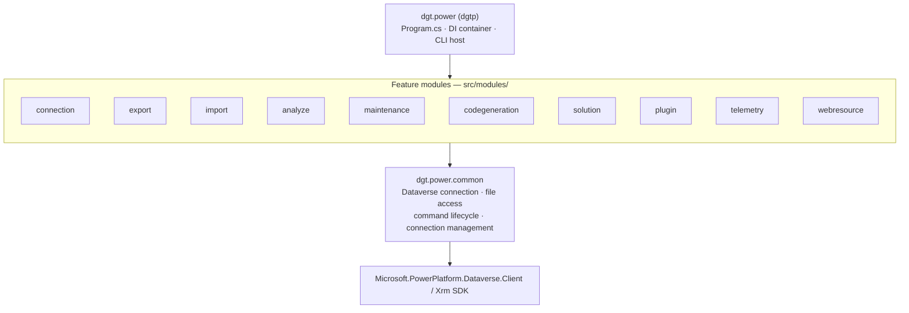

# Solution Architecture

DigitallPower is built as a modular CLI. The host project (`dgt.power`) wires up dependency injection (`Microsoft.Extensions.DependencyInjection`), configuration (`Microsoft.Extensions.Configuration`) and the [Spectre.Console.Cli](https://spectreconsole.net/cli/) command framework, and then registers commands contributed by independent feature modules.

## Key design principles

- **Module isolation.** Every feature area (`analyzer`, `codegeneration`, `connection`, `export`, `import`, `maintenance`, `plugin`, `solution`, `telemetry`, `webresource`) is an independent project under `src/modules/`. Modules expose `Spectre.Console.Cli`-style command classes that are registered by the host.
- **Shared kernel.** `dgt.power.common` provides the cross-cutting infrastructure: `IDataverseConnection`, parsed per-invocation connection settings, typed connection storage and credential construction, protected-storage warnings, file I/O helpers, shared Dataverse query paging, the `PowerCommand<TSettings>` lifecycle base class, telemetry and exception types, plus shared runtime environment helpers (`ExecutionEnvironment`) used by multiple modules.
- **DI everywhere.** Long-lived services (HTTP/NuGet clients, connection store, caches, JSON options) are singletons; per-command services (metadata, config resolver, generators, file service) are scoped. Commands that need Dataverse request `IDataverseConnection` and call `GetServiceAsync()`; the connection is established on first use and cached, so commands that do not need Dataverse never authenticate.
- **Command output.** Every command ends with a rule showing the result and duration (`✔ Command finished in 2.3s` or `✘ Command failed in 0.4s`). Exit codes are unchanged: `0` success, `1` failure, `2` authentication required.
- **Stable connection storage.** `connections.json` and `state.json` live under the per-user dgtp home; secrets and the Azure.Identity token cache use OS-protected persistence.
- **Update awareness.** A `VersionCheckInterceptor` queries NuGet on each run to warn the user when a newer version of `dgt.power` is available.

## Architecture Decision Records

Durable architectural rationale is recorded as ADRs in [`docs/architecture/decisions/`](../architecture/decisions/). See the [ADR index](../architecture/decisions/README.md) for the full list.
